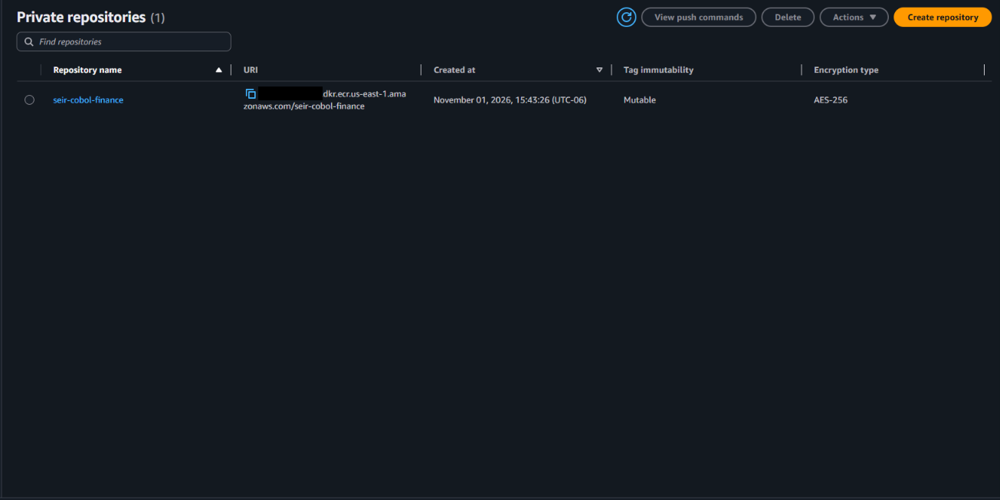
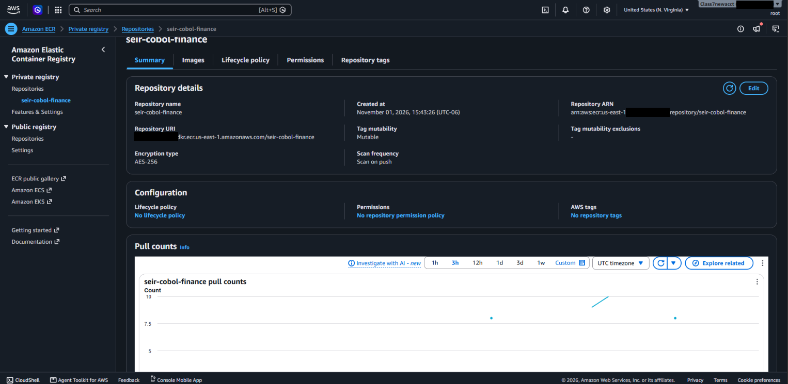

# SEIR Foundations — Module 3 / Lab 01
## Install and run COBOL on Amazon ECS Fargate — Completed Lab Documentation


**Student:** Jerome Hunter
**Date completed:** 2026-11-01
**Region:** us-east-1
**Build host:** Windows 11 + WSL2 (Ubuntu) + Docker Desktop 4.97.0
**Provisioning options:** Option A (`deploy.sh`), then torn down and rebuilt with Option B (Terraform, remote state)

> This document is the **clean happy path**: what to run, in order, and what correct output looks like. Problems hit along the way and how they were fixed are in `Runbook.md`.
>
> Account ID and IAM user ID are redacted as `<ACCOUNT_ID>` / `<USER_ID>`.

### Architecture

```text
Windows 11 laptop → WSL2 Ubuntu (Docker-capable build host)
  └─ Docker build (GnuCOBOL compiled in image)
     └─ Amazon ECR: seir-cobol-finance:lab1
        └─ Amazon ECS cluster: seir-module3
           └─ On-demand Fargate task (private process, no listening port)
              └─ stdout → CloudWatch Logs (/ecs/seir-cobol-batch)
```

**EC2 comparison:** In Module 1, COBOL ran on an EC2 instance whose OS I administered. Here, Fargate provisions the runtime and runs the container image. The task definition describes *how* to launch it; a task is *one* execution. Because this is a batch job that exits when finished, it runs as a one-off **task**, not an always-on **service**.

---

### 0. Prepare the Windows build host (WSL2)

The README states Windows users should use WSL2 with Docker Desktop integration. `deploy.sh` is a Bash script and must run in real Linux.

**PowerShell — install Ubuntu and make it the default WSL distro:**

```powershell
wsl --install -d Ubuntu
wsl --set-default Ubuntu
wsl -l -v
```

```text
  NAME              STATE           VERSION
* Ubuntu            Stopped         2
  docker-desktop    Running         2
```

**PowerShell — enable Docker Desktop WSL integration for Ubuntu (CLI, no GUI):**

```powershell
$f = "$env:APPDATA\Docker\settings-store.json"
Copy-Item $f "$f.bak"
docker desktop stop
$s = Get-Content $f -Raw | ConvertFrom-Json
$s | Add-Member -NotePropertyName EnableIntegrationWithDefaultWslDistro -NotePropertyValue $true -Force
$s | Add-Member -NotePropertyName IntegratedWslDistros -NotePropertyValue @("Ubuntu") -Force
[System.IO.File]::WriteAllText($f, ($s | ConvertTo-Json -Depth 10))
docker desktop start
```

**Ubuntu — confirm Docker is reachable:**

```bash
wsl ~
docker version
```

```text
Client:
 Version:           29.9.2
 OS/Arch:           linux/amd64
Server: Docker Desktop 4.97.0 (244584)
 Engine:
  Version:          29.9.2
  OS/Arch:          linux/amd64
```

**Ubuntu — install AWS CLI v2 (Linux build):**

```bash
sudo apt update && sudo apt install -y unzip
cd ~
curl "https://awscli.amazonaws.com/awscli-exe-linux-x86_64.zip" -o awscliv2.zip
unzip -q awscliv2.zip
sudo ./aws/install
aws --version
```

```text
aws-cli/2.39.3 Python/3.14.8 Linux/6.6.87.2-microsoft-standard-WSL2 exe/x86_64.ubuntu.26
```

**Ubuntu — reuse existing Windows AWS credentials via symlink:**

```bash
ln -s /mnt/c/Users/<WindowsUser>/.aws ~/.aws
```

---

### 1. Extract the bundle and check the tools

Copy the lab onto the Linux filesystem (correct permissions, faster Docker builds) and confirm there are no Windows line endings:

```bash
cp -r /mnt/c/Users/<WindowsUser>/Downloads/seir_cobol_ecs_lab/seir_cobol_ecs_lab ~/seir_cobol_ecs_lab
cd ~/seir_cobol_ecs_lab
ls -l
grep -c $'\r' deploy.sh Dockerfile hello.cbl
```

```text
-rwxr-xr-x 1 jerome jerome  511 Nov  1 15:38 Dockerfile
-rwxr-xr-x 1 jerome jerome 4387 Nov  1 15:38 deploy.sh
-rwxr-xr-x 1 jerome jerome  785 Nov  1 15:38 hello.cbl
drwxr-xr-x 2 jerome jerome 4096 Nov  1 15:38 terraform
deploy.sh:0
Dockerfile:0
hello.cbl:0
```

```bash
aws --version
docker --version
aws sts get-caller-identity
aws ec2 describe-vpcs --filters Name=isDefault,Values=true --query 'Vpcs[0].VpcId' --output text
```

```text
aws-cli/2.39.3 Python/3.14.8 Linux/6.6.87.2-microsoft-standard-WSL2 exe/x86_64.ubuntu.26
Docker version 29.9.2, build a82e528
{
    "UserId": "<USER_ID>",
    "Account": "<ACCOUNT_ID>",
    "Arn": "arn:aws:iam::<ACCOUNT_ID>:user/awscli"
}
vpc-<VPC_ID>
```

The final command returned a VPC ID, not `None`. ✅

---

### 2. Test locally before deploying

```bash
docker build --platform linux/amd64 -t seir-cobol-finance:lab1 .
docker run --rm --platform linux/amd64 seir-cobol-finance:lab1; echo "exit code: $?"
```

Build (key lines):

```text
 => [build 5/5] RUN cobc -x -free -o /seir-finance hello.cbl
 => [stage-1 3/3] COPY --from=build /seir-finance /usr/local/bin/seir-finance
 => => exporting manifest sha256:f7328142d39df48325eb08e5e0b73108040538e7d266b825181a0930ac795d24
 => => naming to docker.io/library/seir-cobol-finance:lab1
```

Run:

```text
SEIR COBOL FINANCIAL BATCH v1
Opening: USD 0012500.00
Debit:   USD 0000250.00
Closing: USD 0012250.00
FINANCIAL INVARIANT PASSED
exit code: 0
```

Exit code `0`. Cleared to deploy. ✅

---

### 3. Deploy to ECS (Option A — script)

```bash
export AWS_REGION=us-east-1
./deploy.sh
```

```text
IAM role created; allowing IAM propagation.
Login Succeeded
...
lab1: digest: sha256:ce7a1da17942febc6ab4a6caf5798a479d1c1f999b601aabfc65a630e42c009f size: 855
Task: arn:aws:ecs:us-east-1:<ACCOUNT_ID>:task/seir-module3/234d8a0271214bc094ab4d805582790b
Exit code: 0; stopped reason: Essential container in task exited
... ecs/cobol/234d8a0271214bc094ab4d805582790b SEIR COBOL FINANCIAL BATCH v1
... ecs/cobol/234d8a0271214bc094ab4d805582790b Opening: USD 0012500.00
... ecs/cobol/234d8a0271214bc094ab4d805582790b Debit:   USD 0000250.00
... ecs/cobol/234d8a0271214bc094ab4d805582790b Closing: USD 0012250.00
... ecs/cobol/234d8a0271214bc094ab4d805582790b FINANCIAL INVARIANT PASSED
```

ECS container exit code `0` and `FINANCIAL INVARIANT PASSED`. ✅

`Essential container in task exited` is the expected stop reason for a batch job that finishes normally.

---

### 4. Verify (performed via CLI instead of Console)

**4.1 ECR — confirm the `lab1` image**

```bash
aws ecr describe-images --repository-name seir-cobol-finance \
  --query 'imageDetails[].{digest:imageDigest,type:imageManifestMediaType,artifact:artifactMediaType}' \
  --output table
```

| Digest | Type | Meaning |
|---|---|---|
| `sha256:f7328142...` | image manifest | The actual COBOL image (matches local build) |
| `sha256:586980eb...` | attestation manifest | Build provenance, added automatically by Docker 29 |
| `sha256:ce7a1da1...` | image index — tagged `lab1` | Points to the two above |

Console confirmation (account ID redacted):





The summary confirms **Scan on push** is enabled. It also shows **Tag mutability: Mutable** and **No lifecycle policy**, both recorded in the hardening backlog in `Runbook.md`.

Scan-on-push results for the actual image:

```bash
aws ecr describe-image-scan-findings --repository-name seir-cobol-finance \
  --image-id imageDigest=sha256:f7328142d39df48325eb08e5e0b73108040538e7d266b825181a0930ac795d24 \
  --query '{status:imageScanStatus,counts:imageScanFindings.findingSeverityCounts}'
```

```text
"status": "COMPLETE"
"counts": { "HIGH": 7, "MEDIUM": 2, "LOW": 2 }
```

All HIGH findings are in Debian base-image packages (`util-linux` ×5, `glibc` ×1, `zlib` ×1), not in the COBOL code. Logged for hardening (see `Runbook.md`).

**4.2 ECS — task, exit code, task definition**

```bash
aws ecs describe-tasks --cluster seir-module3 --tasks <TASK_ARN> \
  --query 'tasks[0].{stopCode:stopCode,stoppedReason:stoppedReason,exitCode:containers[0].exitCode}'
```

```text
"stopCode": "EssentialContainerExited",
"stoppedReason": "Essential container in task exited",
"exitCode": 0
```

**4.3 CloudWatch Logs**

Confirmed in `deploy.sh` output (`aws logs tail /ecs/seir-cobol-batch`): calculation lines and `FINANCIAL INVARIANT PASSED`.

**4.4 Security group — no inbound rules**

```bash
aws ec2 describe-security-groups --group-ids "$SG" \
  --query 'SecurityGroups[0].{name:GroupName,inbound:IpPermissions,outbound:IpPermissionsEgress[].IpRanges[].CidrIp}'
```

```text
"name": "seir-cobol-no-ingress",
"inbound": [],
"outbound": [ "0.0.0.0/0" ]
```

No inbound rules. ✅

---

### 5. Failure exercises

Back up the source first so every drill starts from known-good code:

```bash
cp hello.cbl hello.cbl.orig
```

#### 5.1 Compile failure

```bash
sed -i 's/compute/compyte/' hello.cbl
docker build --platform linux/amd64 -t seir-cobol-finance:broken .
```

```text
hello.cbl:13: error: unknown statement 'compyte'
ERROR: failed to build: ... did not complete successfully: exit code: 1
```

**Result:** Build failed at the `cobc` step. No image was produced and nothing reached AWS. ✅

```bash
cp hello.cbl.orig hello.cbl
```

#### 5.2 Financial invariant failure

```bash
sed -i 's/not = 12250.00/not = 99999.00/' hello.cbl
docker build --platform linux/amd64 -t seir-cobol-finance:broken . && \
docker run --rm --platform linux/amd64 seir-cobol-finance:broken; echo "exit code: $?"
```

```text
Closing: USD 0012250.00
INVARIANT FAILED
exit code: 12
```

Deployed to ECS:

```bash
./deploy.sh; echo "script exit code: $?"
```

```text
Exit code: 12; stopped reason: Essential container in task exited
... ecs/cobol/bf9a216acdbb48d7afb44ee227a67c02 INVARIANT FAILED
script exit code: 1
```

**Result:** The build passed (grammar was valid), but the runtime invariant caught the logic error. ECS reported exit code `12` and CloudWatch shows `INVARIANT FAILED`. The stop reason alone does **not** reveal the failure; the exit code does. ✅

Restored and redeployed:

```bash
cp hello.cbl.orig hello.cbl
./deploy.sh; echo "script exit code: $?"
```

```text
=> => exporting manifest sha256:f7328142d39df48325eb08e5e0b73108040538e7d266b825181a0930ac795d24
Exit code: 0; stopped reason: Essential container in task exited
... ecs/cobol/ec5fa13ca6e849a48fb42ef7a080ccc7 FINANCIAL INVARIANT PASSED
script exit code: 0
```

Image digest matches the original good build (`f7328142...`). ✅

#### 5.3 Bad image tag

```bash
sed 's/:lab1"/:does-not-exist"/' task-definition.json > task-def-badtag.json
BAD_TD=$(aws ecs register-task-definition --cli-input-json file://task-def-badtag.json \
  --query 'taskDefinition.taskDefinitionArn' --output text)

VPC=$(aws ec2 describe-vpcs --filters Name=isDefault,Values=true --query 'Vpcs[0].VpcId' --output text)
SUBNET=$(aws ec2 describe-subnets --filters "Name=vpc-id,Values=${VPC}" --query 'Subnets[0].SubnetId' --output text)
SG=$(aws ec2 describe-security-groups --filters "Name=vpc-id,Values=${VPC}" Name=group-name,Values=seir-cobol-no-ingress --query 'SecurityGroups[0].GroupId' --output text)

TASK=$(aws ecs run-task --cluster seir-module3 --launch-type FARGATE \
  --task-definition "$BAD_TD" --count 1 \
  --network-configuration "awsvpcConfiguration={subnets=[${SUBNET}],securityGroups=[${SG}],assignPublicIp=ENABLED}" \
  --query 'tasks[0].taskArn' --output text)
aws ecs wait tasks-stopped --cluster seir-module3 --tasks "$TASK"
aws ecs describe-tasks --cluster seir-module3 --tasks "$TASK" \
  --query 'tasks[0].{stopCode:stopCode,stoppedReason:stoppedReason,exitCode:containers[0].exitCode}'
```

```text
"stopCode": "TaskFailedToStart",
"stoppedReason": "CannotPullContainerError: ... seir-cobol-finance:does-not-exist: not found",
"exitCode": null
```

**Result:** The container never started (`exitCode: null`, no CloudWatch logs). ECR was reachable and authorized but the tag did not exist. Distinguished from a COBOL runtime defect, which produces a numeric exit code. ✅

Removed the bad revision from rotation:

```bash
aws ecs deregister-task-definition --task-definition "$BAD_TD" \
  --query 'taskDefinition.{revision:revision,status:status}'
```

```text
"revision": 4,
"status": "INACTIVE"
```

#### 5.4 IAM failure (image-pull permission removed)

Performed in my own isolated account, on the lab-only execution role.

```bash
aws iam list-attached-role-policies --role-name seir-ecs-task-execution-lab --output table
aws iam detach-role-policy --role-name seir-ecs-task-execution-lab \
  --policy-arn arn:aws:iam::aws:policy/service-role/AmazonECSTaskExecutionRolePolicy
sleep 15
TASK=$(aws ecs run-task --cluster seir-module3 --launch-type FARGATE \
  --task-definition seir-cobol-batch:3 --count 1 \
  --network-configuration "awsvpcConfiguration={subnets=[${SUBNET}],securityGroups=[${SG}],assignPublicIp=ENABLED}" \
  --query 'tasks[0].taskArn' --output text)
aws ecs wait tasks-stopped --cluster seir-module3 --tasks "$TASK"
aws ecs describe-tasks --cluster seir-module3 --tasks "$TASK" \
  --query 'tasks[0].{stopCode:stopCode,stoppedReason:stoppedReason,exitCode:containers[0].exitCode}'
```

```text
"stopCode": "TaskFailedToStart",
"stoppedReason": "ResourceInitializationError: unable to pull secrets or registry auth: ...
  AccessDeniedException: User: arn:aws:sts::<ACCOUNT_ID>:assumed-role/seir-ecs-task-execution-lab/...
  is not authorized to perform: ecr:GetAuthorizationToken on resource: *
  because no identity-based policy allows the ecr:GetAuthorizationToken action",
"exitCode": null
```

Restored and verified:

```bash
aws iam attach-role-policy --role-name seir-ecs-task-execution-lab \
  --policy-arn arn:aws:iam::aws:policy/service-role/AmazonECSTaskExecutionRolePolicy
sleep 15
# same run-task / wait / describe-tasks as above
```

```text
"stopCode": "EssentialContainerExited",
"stoppedReason": "Essential container in task exited",
"exitCode": 0
```

**Result:** Same command failed without the policy and succeeded with it, isolating the IAM permission as the sole cause. ✅

#### Failure exercise summary

| Exercise | Caught at | `exitCode` | Key evidence |
|---|---|---|---|
| Compile failure | Docker build | n/a | `unknown statement 'compyte'` |
| Invariant failure | ECS runtime | `12` | `INVARIANT FAILED` in CloudWatch |
| Bad image tag | Before container start | `null` | `CannotPullContainerError ... not found` |
| IAM failure | Before container start | `null` | `ResourceInitializationError ... AccessDeniedException` |

---

### 6. Next labs

Not part of this lab. Ready to proceed to the COBOL HTTP adapter / ECS service lab.

---


### 7. Cleanup — Option A teardown

The README requires choosing **one** provisioning option per account, because both create resources with the same names. Option A was torn down completely before running Option B.

**Before:** confirmed nothing was running and the cluster had no services.

```bash
aws ecs list-tasks --cluster seir-module3 --desired-status RUNNING --query taskArns
aws ecs describe-clusters --clusters seir-module3 \
  --query 'clusters[0].{status:status,running:runningTasksCount,services:activeServicesCount}'
```

```text
[]
{ "status": "ACTIVE", "running": 0, "services": 0 }
```

**Teardown, one resource at a time, verifying each:**

```bash
# 1. ECS cluster
aws ecs delete-cluster --cluster seir-module3

# 2. ECR repository and images
aws ecr delete-repository --repository-name seir-cobol-finance --force

# 3. CloudWatch log group
aws logs delete-log-group --log-group-name /ecs/seir-cobol-batch

# 4. Security group (confirmed no ENIs still attached first)
aws ec2 describe-network-interfaces --filters Name=group-id,Values=<SG_ID> \
  --query 'NetworkInterfaces[].NetworkInterfaceId'
aws ec2 delete-security-group --group-id <SG_ID>

# 5. IAM role (confirmed no inline policies; detached managed policy first)
aws iam list-role-policies --role-name seir-ecs-task-execution-lab --query PolicyNames
aws iam detach-role-policy --role-name seir-ecs-task-execution-lab \
  --policy-arn arn:aws:iam::aws:policy/service-role/AmazonECSTaskExecutionRolePolicy
aws iam delete-role --role-name seir-ecs-task-execution-lab

# 6. Retire remaining active task definition revisions
for td in $(aws ecs list-task-definitions --family-prefix seir-cobol-batch --status ACTIVE \
    --query 'taskDefinitionArns[]' --output text); do
  aws ecs deregister-task-definition --task-definition "$td"
done
```

**After:**

| Resource | Before | After |
|---|---|---|
| ECS cluster | ACTIVE | `INACTIVE` ✅ |
| ECR repository | exists | `RepositoryNotFoundException` ✅ |
| Log group | exists | `[]` ✅ |
| Security group | exists | `[]` ✅ |
| IAM role | exists | `NoSuchEntity` ✅ |
| Active task definitions | 3 | `[]` ✅ |

The shared default VPC was not touched.

---

### 8. Option B — Terraform with remote state

#### 8.1 Remote state backend

State is stored remotely in an existing, private S3 bucket rather than on the laptop. The bucket has **versioning enabled**, **default encryption**, and **all public access blocked**. Terraform's native S3 locking (`use_lockfile`, Terraform 1.10+) prevents concurrent runs, so no DynamoDB table is needed.

`terraform/backend.tf`:

```hcl
terraform {
  backend "s3" {
    bucket       = "<STATE_BUCKET>"
    key          = "seir-module3-lab01/terraform.tfstate"
    region       = "<BUCKET_REGION>"
    encrypt      = true
    use_lockfile = true
  }
}
```

The project uses its own `key` prefix so it cannot collide with other state files in the bucket.

#### 8.2 Initialize, plan, apply

```bash
cd ~/seir_cobol_ecs_lab/terraform
terraform init
```

```text
Successfully configured the backend "s3"!
- Installed hashicorp/aws v6.71.0 (signed by HashiCorp)
Terraform has been successfully initialized!
```

Plan saved to a file, reviewed, then applied exactly as reviewed:

```bash
terraform plan -out=lab.tfplan
terraform apply lab.tfplan
```

```text
  # aws_cloudwatch_log_group.batch will be created
  # aws_ecr_repository.cobol will be created
  # aws_ecs_cluster.lab will be created
  # aws_ecs_task_definition.batch will be created
  # aws_iam_role.task_execution will be created
  # aws_iam_role_policy_attachment.task_execution will be created
  # aws_security_group.no_ingress will be created
Plan: 7 to add, 0 to change, 0 to destroy.

Apply complete! Resources: 7 added, 0 changed, 0 destroyed.
```

#### 8.3 Confirm state is remote

```bash
aws s3 ls "s3://<STATE_BUCKET>/seir-module3-lab01/"
ls -la | grep -i tfstate || echo "No local state file - good"
terraform state list
```

```text
terraform.tfstate          (stored in S3)
No local state file - good
data.aws_caller_identity.current
data.aws_subnets.default
data.aws_vpc.default
aws_cloudwatch_log_group.batch
aws_ecr_repository.cobol
aws_ecs_cluster.lab
aws_ecs_task_definition.batch
aws_iam_role.task_execution
aws_iam_role_policy_attachment.task_execution
aws_security_group.no_ingress
```

#### 8.4 Push the image and run the task

Values are read from Terraform outputs instead of copied by hand:

```bash
REPO=$(terraform output -raw ecr_repository_url)
aws ecr get-login-password --region us-east-1 | docker login --username AWS --password-stdin "${REPO%%/*}"
docker build --platform linux/amd64 -t "$REPO:lab1" ..
docker push "$REPO:lab1"

TASK=$(aws ecs run-task --cluster "$(terraform output -raw cluster_name)" \
  --launch-type FARGATE --task-definition "$(terraform output -raw task_definition_family)" --count 1 \
  --network-configuration "awsvpcConfiguration={subnets=[$(terraform output -raw subnet_id)],securityGroups=[$(terraform output -raw security_group_id)],assignPublicIp=ENABLED}" \
  --region us-east-1 --query 'tasks[0].taskArn' --output text)
aws ecs wait tasks-stopped --cluster seir-module3 --tasks "$TASK" --region us-east-1
aws ecs describe-tasks --cluster seir-module3 --tasks "$TASK" --region us-east-1 \
  --query 'tasks[0].{stopCode:stopCode,exitCode:containers[0].exitCode,taskDef:taskDefinitionArn}'
aws logs tail /ecs/seir-cobol-batch --log-stream-name-prefix "ecs/cobol/${TASK##*/}" --region us-east-1
```

```text
"stopCode": "EssentialContainerExited",
"exitCode": 0,
"taskDef": "arn:aws:ecs:us-east-1:<ACCOUNT_ID>:task-definition/seir-cobol-batch:5"

... ecs/cobol/ea8f4b02b56f48378c659f11a98c0875 SEIR COBOL FINANCIAL BATCH v1
... ecs/cobol/ea8f4b02b56f48378c659f11a98c0875 Opening: USD 0012500.00
... ecs/cobol/ea8f4b02b56f48378c659f11a98c0875 Debit:   USD 0000250.00
... ecs/cobol/ea8f4b02b56f48378c659f11a98c0875 Closing: USD 0012250.00
... ecs/cobol/ea8f4b02b56f48378c659f11a98c0875 FINANCIAL INVARIANT PASSED
```

Exit code `0` on Terraform's task definition revision. ✅

#### 8.5 Difference from Option A: log retention

```bash
aws logs describe-log-groups --log-group-name-prefix /ecs/seir-cobol-batch --region us-east-1 \
  --query 'logGroups[0].{name:logGroupName,retentionDays:retentionInDays}'
```

```text
{ "name": "/ecs/seir-cobol-batch", "retentionDays": 7 }
```

Option A set no retention (logs kept indefinitely). The Terraform version sets 7 days, closing hardening backlog item #3.

#### 8.6 Terraform destroy

Destroy plan saved and reviewed before applying:

```bash
terraform plan -destroy -out=destroy.tfplan
terraform show -no-color destroy.tfplan | grep "will be destroyed"
terraform apply destroy.tfplan
```

```text
  # aws_cloudwatch_log_group.batch will be destroyed
  # aws_ecr_repository.cobol will be destroyed
  # aws_ecs_cluster.lab will be destroyed
  # aws_ecs_task_definition.batch will be destroyed
  # aws_iam_role.task_execution will be destroyed
  # aws_iam_role_policy_attachment.task_execution will be destroyed
  # aws_security_group.no_ingress will be destroyed

Apply complete! Resources: 0 added, 0 changed, 7 destroyed.
```

The default VPC and subnets were read-only `data` lookups and were not touched. The state bucket was created outside this configuration and was not affected.

```bash
terraform state list
```

```text
(empty)
```

The state file remains in S3 as an empty state, so the stack can be rebuilt with `terraform apply`. Bucket versioning retains the previous state version.

---

### Option A vs Option B

| | Option A (script) | Option B (Terraform) |
|---|---|---|
| Build | `./deploy.sh` | `plan` → review → `apply` |
| Log retention | None (indefinite) | 7 days |
| State | None | Remote S3, versioned, encrypted, locked |
| Teardown | 6 manual steps with verification | One reviewed destroy plan |
| Result | `exitCode 0` | `exitCode 0` |

---

### Completion checklist

| Section | Status |
|---|---|
| 1. Extract and check tools | ✅ |
| 2. Local test | ✅ |
| 3. Deploy (Option A) | ✅ |
| 4. Verify (ECR, ECS, CloudWatch, Security Group) | ✅ |
| 5. Failure exercises (all 4) | ✅ |
| 7. Option A teardown | ✅ |
| 8. Option B — Terraform with remote state | ✅ |
| 8.6 Terraform destroy | ✅ |
